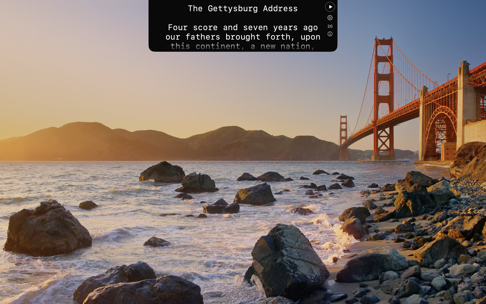
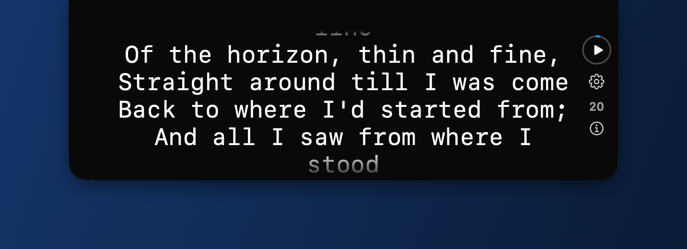
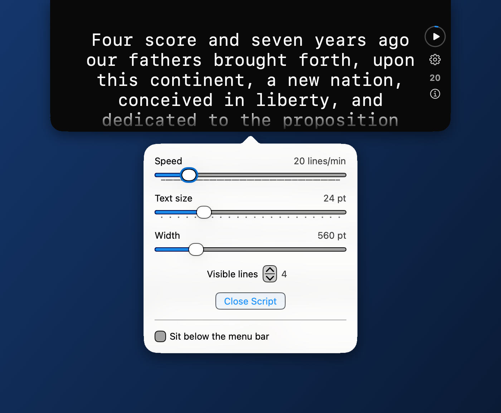
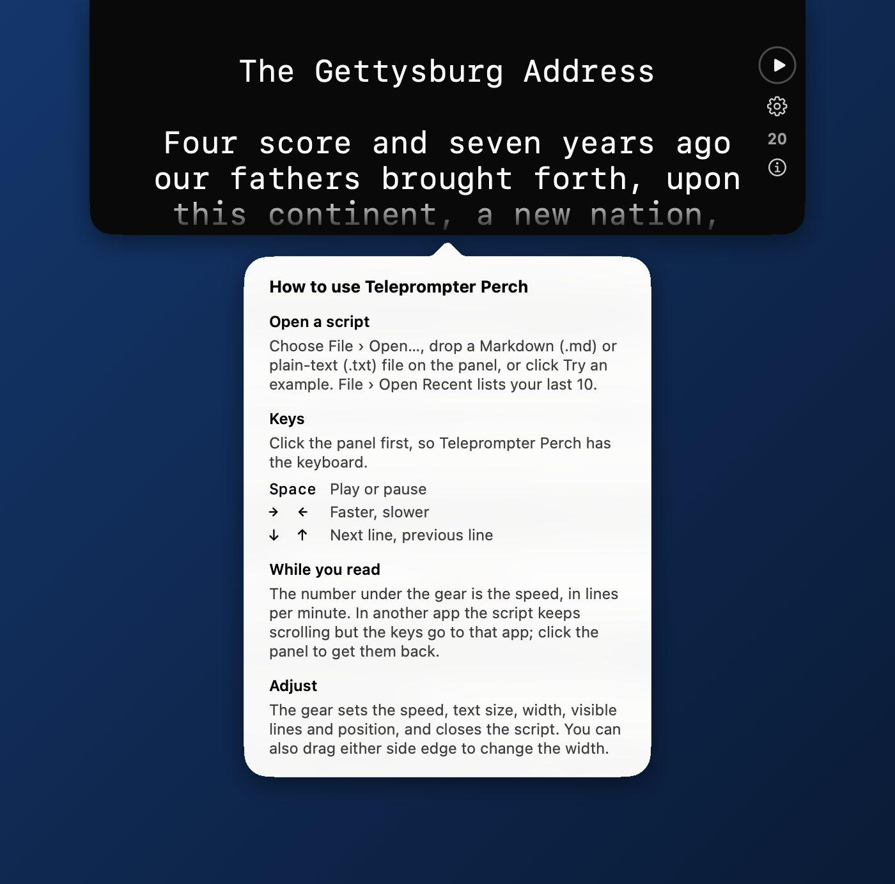

<p align="center"></p>

# Teleprompter Perch

A free teleprompter for the Mac. It sits at the top center of your screen,
right under the camera, and slowly scrolls your script so you can read while
looking almost straight into the lens. Handy for video calls, recordings and
presentations.

- Reads scripts you write elsewhere: Markdown (`.md`, `.markdown`) or plain
  text (`.txt`).
- **Space** plays and pauses. **Right/Left Arrow** speed it up or slow it
  down. **Down/Up Arrow** move one line ahead or back.
- Stays on top of other apps and keeps scrolling while you use them.
- Adjustable width, text size, speed and number of lines; remembers your
  settings and your last 10 scripts.
- Comes with 12 famous speeches and poems to practice with.
- No account, no internet access, no camera or microphone access.

## Screenshots

<p align="center"></p>

<p align="center"><em>On the desktop: the panel sits at the top center, right under the camera.</em></p>

<p align="center"></p>

<p align="center"><em>Renascence, by Edna St. Vincent Millay, one of the 12 bundled examples.</em></p>

<p align="center"></p>

<p align="center"><em>The settings, under the gear: speed, text size, width and visible lines.</em></p>

<p align="center"></p>

<p align="center"><em>The i button explains the keys.</em></p>

## Download

**[Download the latest version](https://github.com/joemoreno/TeleprompterPerch-app/releases/latest)**
(the `.zip` file under Assets).

Requires **macOS 27 or later** on a Mac with **Apple silicon** (M1 or later).

## Install

Teleprompter Perch isn't distributed through the Mac App Store and isn't notarized
by Apple, so the first time you open it, macOS asks you to confirm that you
trust it. You only do this once.

1. Download the `.zip` file and double-click it to unzip it.
2. Drag **Teleprompter Perch** into your **Applications** folder.
3. Open it from Applications. macOS says it can't verify the app. Click
   **Done** (not Move to Trash).
4. Open **System Settings**, choose **Privacy & Security**, and scroll down
   to **Security**. You'll see a note that Teleprompter Perch was blocked. Click
   **Open Anyway**.
5. Enter your Mac password if asked, then click **Open** in the dialog that
   appears.

After that, Teleprompter Perch opens normally, like any other app.

If you're comfortable with Terminal, this one command does the same as steps
3–5 (after step 2):

```bash
xattr -dr com.apple.quarantine "/Applications/Teleprompter Perch.app"
```

## Getting started

Click **Try an example** to load one of 12 famous speeches and poems, or
choose **File › Open…** to open your own script. It opens paused at the top;
press **Space** to start. The gear button opens the settings, and the **i**
button under the speed shows short instructions.

## License

Teleprompter Perch is free to use under the [Teleprompter Perch Freeware License](LICENSE).
Please share a link to this page rather than the app itself.

© 2026 Joe Moreno
